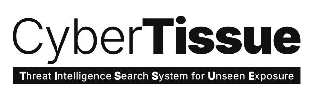

<p align="center">
  
</p>

---

## 소개

<strong>CyberTissue</strong>는 숨은 노출을 찾는 위협 인텔리전스 검색 시스템(**T**hreat **I**ntelligence **S**earch **S**ystem for **U**nseen **E**xposure)입니다. 여러 공개 정보에서 사이버 위협 관련 정보를 **검색하고, 수집하고, 가시화**하기 위한 개인 연구 프로젝트입니다.

또한 CyberTissue는 이름에서와 같이 아래 세 가지 주제를 함께 다룹니다.

<p align="center">
  
</p>

조직·도메인 관련 공개 정보, 침해·유출 관련 언급, 랜섬웨어 유출 사이트와 공개 채널의 게시물, IP·도메인·해시 등의 IOC를 조사합니다. 목적은 위협을 자동 판정하거나 공격을 수행하는 것이 아니라, **찾은 정보의 출처와 조회 범위를 분명히 하여 연구자가 직접 살펴볼 수 있게 하는 것**입니다.

> **Find it. Surface it.** — 찾고, 보여줍니다. 최종 해석과 판단은 사람의 몫입니다.

## 조사 노트

CyberTissue로 살펴본 사건 정리는 노트 사이트에 올립니다.

**https://jsik22.github.io/cybertissue-notes/**

## 주요 특징

- **다중 소스 조회:** CT 로그, Passive DNS, 유출 사건 정보, 랜섬웨어 추적 정보, 공개 Telegram 채널, IOC 평판 등을 조사합니다.
- **에이전트 중심 워크플로:** Claude Code가 조사 범위를 읽고 조회 결과를 요약합니다. 소스별 조회 도구는 판단 대신 데이터 조회와 표준 형식 반환에 집중합니다.
- **커버리지 기록:** 결과가 없었던 소스, 조회에 실패한 소스, 키·세션 부족으로 건너뛴 소스를 구분합니다. "결과 없음"은 그 소스에서 찾지 못했다는 뜻이지 노출이 없다는 뜻이 아닙니다.
- **회차별 비교:** 같은 주제를 반복 조회하고 이전 회차와 달라진 점을 확인합니다.
- **소스 생애주기 관리:** 소스는 계속 바뀝니다. 후보 발굴부터 검증·편입·유지·퇴출까지 상태와 확인 이력을 기록합니다.

## 작동 방식

```text
조사 요청 (도메인 · IOC · 키워드 · 이슈)
           │
           ▼
   Claude Code + CyberTissue
   범위 확인 · 조회 계획
           │
           ▼
   소스별 조회 → 표준 형식 결과
           │
           ▼
   회차별 결과 · 원본 응답 보관
           │
           ├── 조회 커버리지
           ├── 요약 (관찰 · 추론 · 불확실 구분)
           └── 텍스트 보고서
```

결과는 **위협의 확정 판정이 아니라 조사 가능한 단서**입니다. 소스에 게시물이 있다는 사실과 게시물의 내용이 사실이라는 것은 구분합니다.

## 사용 범위 및 데이터 취급

CyberTissue는 **공개 정보 검색과 허용된 읽기 전용 조회**를 지향합니다. 공격·침투·인증 우회 도구가 아닙니다.

- 공격적인 포트 스캔이나 취약점 악용은 수행 범위에 포함하지 않습니다.
- 로그인 기반 소스는 해당 서비스의 규칙과 적용 법률을 따르며, 사람의 인증이 필요한 작업을 자동 우회하지 않습니다. 게시·댓글·메시지 작성은 하지 않습니다.
- 유출 자료의 본문 파일이나 불법 콘텐츠는 내려받지 않습니다. 개인 식별 정보가 포함된 자료는 최소한으로 취급하고, 공개하는 글에는 메타정보만 남깁니다.
- 외부 소스에 게시된 주장과 검증된 사실을 구분합니다. **미확인 게재·판매글을 실제 침해 또는 유출 확정으로 표현하지 않습니다.**

## 코드

이 저장소는 프로젝트 소개용입니다. 조사 도구와 절차 문서는 공개하지 않습니다.

---

<p align="center"><sub>CyberTissue · Threat Intelligence Search System for Unseen Exposure</sub></p>
<p align="center"><sub>로고의 글자는 Inter(SIL Open Font License 1.1, © The Inter Project Authors)의 윤곽선입니다.</sub></p>
